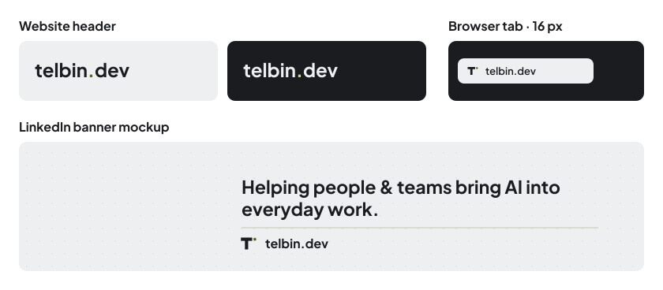

# telbin.dev brand guide

## Logo

[Adaptive SVG](brand/waypoint.svg) · [Light SVG](brand/waypoint-light.svg) · [Dark SVG](brand/waypoint-dark.svg) · [LinkedIn Banner PNG](brand/linkedin-banner.png) · [LinkedIn Banner SVG](brand/linkedin-banner.svg)

- **Website header** — Lowercase wordmark `telbin.dev` in **Plus Jakarta Sans** (`700` weight). Color the period burnt orange and keep letters neutral. Omit the Waypoint icon so the orange accent isn't doubled.
- **Favicon** — Use [brand/waypoint.svg](brand/waypoint.svg) on its own (`16 units = 1 px` on the `256×256` grid, keeping a crisp `1 px` gap between the **T** and the dot at `16 px`).
- **Banners & lockups** — Place Waypoint before a fully neutral `telbin.dev` (including a neutral period) so only the Waypoint dot carries the orange accent. Keep at least one dot-radius (`20` units) of clear space around the mark.

## Palette

Use burnt orange sparingly for brand signatures (Waypoint dot, wordmark period, subtle dividers). Keep interactive UI elements (links, buttons, tags) on `--link-color`.

| Role | CSS Token | Light mode | Dark mode |
| --- | --- | --- | --- |
| Background | `--background-color` | `#EEEFF1` | `#1A1C20` |
| Foreground (`T`, wordmark, text) | `--text-color` | `#1A1C20` | `#EEEFF1` |
| Brand accent (Waypoint dot, `.`) | `--brand-accent` | `#B14A2D` | `#FF986E` |
| Interactive UI (links, buttons) | `--link-color` | `#365FD1` | `#4C9AFF` |

## Typography

Use **Plus Jakarta Sans** across all brand touchpoints (wordmark, website, CV, and social banners):

- **Font stack:** `"Plus Jakarta Sans", system-ui, -apple-system, Helvetica, Arial, sans-serif`
- **Weights:** `700` (Bold) for the `telbin.dev` wordmark and headings; `400`–`600` for body copy and UI labels.
